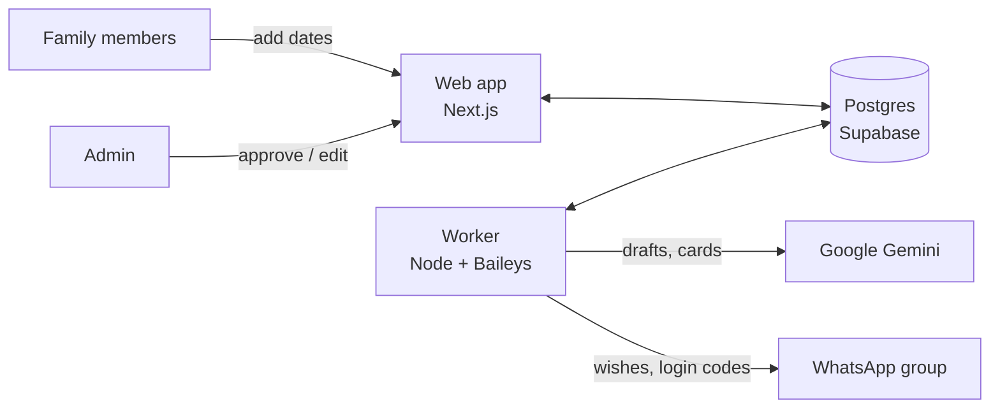

# Family Wishes

Family Wishes posts a warm birthday, anniversary or festival wish to your family WhatsApp group every morning, after the admin has approved it.

- Family members add birthdays, anniversaries and special days on a small website.
- The evening before, Gemini drafts a short wish for each occasion. It can also draw a greeting card.
- The admin checks each draft on the website or by replying on WhatsApp.
- Approved wishes post to the group at the send time. Nothing posts without approval.

## How it fits together



The **web app** and the **worker** never call each other. They share one Postgres database, and the worker checks it every 5 seconds (posting, login codes, "run now" buttons) and every 60 seconds (drafting, expiry, daily jobs).

| Path | What it is |
| --- | --- |
| `apps/web` | Next.js website: sign-in, entries, admin pages |
| `apps/worker` | Long-running process: WhatsApp connection, drafting, posting, backups |
| `packages/core` | Shared logic: dates, occurrences, wish and card prompts, Gemini clients |
| `packages/db` | Drizzle schema and queries, migration runner, in-memory test database |
| `supabase/migrations` | SQL migrations, including the festival dates for 2026–27 |
| `deploy/worker` | Docker Compose file for running the worker on a server |

## Run it locally

### 1. Prerequisites

- **Node.js 24** and npm 11
- A **Supabase** project (the free plan is enough)
- A **Gemini API key** from [Google AI Studio](https://aistudio.google.com/apikey)
- A phone with **WhatsApp**, to link the worker as a device

### 2. Install

```powershell
npm install
```

### 3. Create `.env`

Copy `.env.example` to `.env` in the repository root and fill it in:

| Variable | Required | What to put |
| --- | --- | --- |
| `DATABASE_URL` | yes | Supabase → **Connect** → *Transaction pooler* URI (port 6543). If your password contains `@`, `#` or `/`, write it percent-encoded. |
| `GEMINI_API_KEY` | yes | Your Gemini API key |
| `GEMINI_MODEL` | no | Text model for wishes. Default `gemini-3.5-flash-lite` |
| `GEMINI_IMAGE_MODEL` | no | Gemini image model for greeting cards. Default `gemini-3.1-flash-image` |
| `POLLINATIONS_API_KEY` | no | A Pollinations secret key (`sk_...`). When set, greeting cards are made by Pollinations instead of Gemini |
| `POLLINATIONS_IMAGE_MODEL` | no | Pollinations image model. Default `tongyi-mai/z-image-turbo` |
| `ADMIN_PHONE` | yes | The admin's WhatsApp number, international digits without `+`, e.g. `919876543210` |
| `ADMIN_PASSWORD` | web | At least 16 characters; used at `/login/admin` |
| `SESSION_SECRET` | web | At least 32 random characters |
| `BACKUP_DIR` | no | Where the worker writes nightly JSON backups. Default `/data/backups` |
| `LOG_LEVEL` | no | Worker log level. Default `info` |

To generate a `SESSION_SECRET` in PowerShell:

```powershell
$b = New-Object byte[] 36; [Security.Cryptography.RandomNumberGenerator]::Create().GetBytes($b); [Convert]::ToBase64String($b)
```

Next.js only reads env files from its own folder, so give the web app the same values:

```powershell
Copy-Item .env apps/web/.env.local
```

`.env` and `.env.local` are git-ignored. Never commit them.

### 4. Create the tables

```powershell
npm run db:migrate
```

This applies every file in `supabase/migrations` that hasn't run yet, and is safe to run again. All tables have row-level security turned on with no policies, so Supabase's public API keys can't read them. The app connects directly as the database owner.

### 5. Start the web app

```powershell
cd apps/web
npx next dev -p 3000
```

Open <http://localhost:3000>.

### 6. Start the worker

In a second terminal, from the repository root:

```powershell
$env:BACKUP_DIR = "$PWD\backups"   # optional: keep backups inside the repo folder (git-ignored)
npm run worker:dev
```

Keep this terminal open. Nothing is drafted or posted while the worker is stopped.

### 7. Link WhatsApp and choose the group

1. Sign in as admin at <http://localhost:3000/login/admin> with `ADMIN_PASSWORD`.
2. Go to **Admin → WhatsApp** and scan the QR code from your phone (WhatsApp → **Linked devices** → **Link a device**).
3. Once it shows *Connected*, pick the family group from the list. **Try a test group first.**

The link is saved in the database, so restarting the worker reconnects without a new QR code.

### 8. Try it end to end

1. **Add an entry** dated **today**. Within a minute the worker drafts a wish and sends you a summary in your WhatsApp *Message yourself* chat.
2. Open **Admin → Drafts**. Today's draft shows as a WhatsApp-style message.
3. Click **Approve & post now**. The wish arrives in the group within a few seconds.

Family members sign in at `/login` with their phone number; the code arrives on WhatsApp. Add them under **Admin → Members** first.

## Daily schedule

All times use the time zone set in **Admin → Settings** (default `Asia/Kolkata`) and can be changed there.

| When | What happens |
| --- | --- |
| 20:00 | Tomorrow's wishes are drafted and sent to the admin for approval |
| 07:00 | Reminder to the admin if anything is still waiting |
| 08:00 | Approved wishes post to the group |
| 02:00 | JSON backup of members, entries, festivals and settings |
| 1 Dec | Reminder to add next year's festival dates |

Today's occasions are drafted as soon as the worker sees them, so an entry added for today still gets a wish.

The admin can also reply on WhatsApp instead of using the website:

| Reply | Effect |
| --- | --- |
| `ok` (or `yes`, 👍) | Approve every waiting wish, or just one with its number, e.g. `ok 2` |
| `skip 1` / `redo 1` | Skip a wish, or ask Gemini for a new one (the number is optional when only one is waiting) |
| `2 <new text>` | Replace wish 2 with your own text. With only one wish waiting, just send the new text |

## Greeting cards

When **Greeting cards** is on in Settings, the worker draws a card for each draft and the wish posts as the card's caption in a single message. On the Drafts page you can make a new card or remove one.

Cards come from **Pollinations** when `POLLINATIONS_API_KEY` is set, otherwise from **Gemini**:

- **Pollinations** (recommended): `tongyi-mai/z-image-turbo` works on Pollinations' free Quest Pollen. Get a secret key at [enter.pollinations.ai](https://enter.pollinations.ai/keys). Pollinations keeps generated images at unlisted public URLs for about 30 days.
- **Gemini**: image models have no free-tier quota, so billing must be enabled on the Google project that owns your key.

If a card can't be made, no card is saved and the wish posts as text.

## Develop without Supabase

For UI work you can point the **web app** at a local, file-based Postgres (PGlite) instead:

```text
# apps/web/.env.local
DATABASE_URL=pglite:C:/path/to/repo/.pglite-dev
```

Run `npx tsx --env-file=apps/web/.env.local packages/db/src/migrate.ts` once to create the tables. PGlite allows one process at a time, so the worker can't share it. Use Supabase when you need WhatsApp.

## Checks

```powershell
npm test                              # all unit and integration tests (Vitest, PGlite in memory)
npm run coverage                      # same, with a coverage report
npm run typecheck                     # every package
npm run lint -w @family-wishes/web    # ESLint for the web app
npm run e2e                           # Playwright smoke test (starts next dev on port 3100 with a throwaway PGlite database)
```

The first time, install the browser with `npx playwright install chromium`.

## Troubleshooting

| Symptom | Fix |
| --- | --- |
| A button on the website does nothing or errors after many code edits | Restart `next dev`. Turbopack can serve stale server actions after many hot reloads. |
| The QR code never appears | Check the worker terminal is running and its `DATABASE_URL` matches the web app's. |
| `429 ... free_tier ... limit: 0` in the worker log | That Gemini model has no free quota on your key: set `POLLINATIONS_API_KEY`, enable Gemini billing, or turn cards off in Settings. |
| `Pollinations returned HTTP 402` | Your Pollinations balance or key budget is used up; top up or pick a cheaper model. |
| Wishes are drafted but never post | Check a group is chosen on the WhatsApp page and that the drafts are approved. |
| `Invalid web environment` / `Invalid worker environment` | The message names the bad variable; compare it with the table above. |

## Deployment

The web app runs on Vercel and the worker on a small always-on server (an Oracle Cloud Always Free VM or a Google Cloud e2-micro) using `apps/worker/Dockerfile` and `deploy/worker/docker-compose.yml`. Follow the step-by-step guide in [docs/deploy.md](docs/deploy.md), which ends with the go-live checklist.
