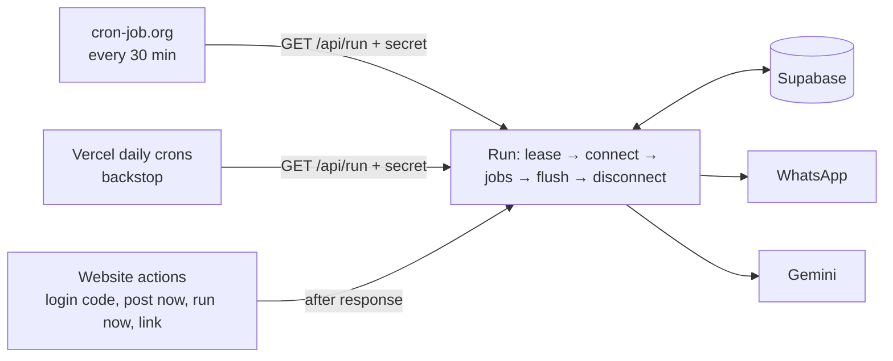

# Family Wishes on Vercel only — Design

Date: 2026-11-01 · Status: **draft, awaiting approval** · Builds on [2026-10-24-family-wishes-design.md](2026-10-24-family-wishes-design.md)

## Context

The original design runs the WhatsApp worker as an always-on process on an Oracle Cloud Always Free VM. The user couldn't create an Oracle account. Google Cloud's e2-micro works but costs about $4 a month (public IPv4), and there is no other free always-on server. The user chose to run **everything on Vercel's free (Hobby) plan**, with WhatsApp work done in short runs triggered **every 30 minutes** by an outside scheduler, instead of a permanently connected worker.

After deployment, the next phase is **website design work** (the user's main focus). This change should leave the web UI as it is except where the new way of running forces a change.

## Goals

- No always-on server: website, scheduled WhatsApp work and on-demand WhatsApp work all run as Vercel functions on the Hobby plan, plus a free outside scheduler. Monthly cost stays $0.
- Every existing behaviour keeps working, with these timings:
  - Drafting, the morning reminder, posting and backups happen at the first run at or after their set time (runs at :00 and :30).
  - Login codes, **Approve & post now** and the two **Run now** buttons start a run immediately, so they arrive within about 30 seconds.
  - Admin replies on WhatsApp are applied at the next run (≤ 30 minutes), and answered then.
- The guarantees from the original design still hold, especially:
  - an unapproved draft never posts;
  - a wish never posts twice;
  - the worker never treats its own messages as admin replies;
  - the worker only messages the group, the admin's own chat and listed members.

## Non-goals

- Website visual redesign (next phase). Only the WhatsApp page and a few lines of copy change here.
- Upgrading to Vercel Pro, paid schedulers or any paid service.
- Removing the always-on mode. It stays available for local development and for a future VM (see Approaches).

## Anti-goals

- Getting the admin's WhatsApp number banned. Reconnecting about 50 times a day from cloud IPs is the new risk; it is measured during the spike and on the test number before the real number is used.
- A birthday silently missed because a run failed or the scheduler stopped calling.
- Two runs connected to WhatsApp at the same time (they disconnect each other and can corrupt the saved session).
- A wish or login code sent twice because a run was cut off mid-send.

## Constraints

Checked against Vercel's docs on 2026-11-01:

- **Vercel Hobby cron jobs run at most once per day**, anywhere within the scheduled hour. Up to 100 per project.
- **Hobby functions run for at most 300 seconds.**
- Free monthly usage is **4 active CPU-hours**, 1M invocations and 360 GB-hours of memory.
- Hobby is for **personal, non-commercial use**. A family app qualifies.
- The outside scheduler must reach a public URL every 30 minutes with a secret header.
- **Supabase's transaction pooler (port 6543)** does not keep session-level Postgres advisory locks between statements. Mutual exclusion therefore needs a **lease row**, not `pg_advisory_lock`.
- Baileys 7.0.0-rc14 (pinned):
  - `connection.update` reports `receivedPendingNotifications: true` once WhatsApp has delivered everything queued while the device was offline.
  - History sync can be turned off with `syncFullHistory: false` and `shouldSyncHistoryMessage: () => false`.
- Vercel has no persistent disk, so backups cannot be written to `/data/backups`.

## Approaches considered

| | Approach | Trade-off |
|---|---|---|
| **A (chosen by the user)** | Short "connect, do work, disconnect" runs on Vercel, every 30 min from an outside scheduler, plus immediate runs started by the website | $0. Replies are handled within 30 min, not instantly. Needs a spike to prove offline replies and frequent reconnects work. |
| B | Vercel Hobby daily crons only | $0, but drafting/posting happen at a random minute in the hour, and admin WhatsApp replies are effectively unusable. Rejected as too clunky. |
| C | Keep the always-on worker on Google Cloud e2-micro or a home computer | Most reliable and no code change, but about $4 a month, or needs a machine that is always on. The user declined. |

## Decided by the user

- Approach A, with the outside scheduler calling **every 30 minutes** (not 15).
- Website design work comes after deployment, as its own phase.

## Architecture

### Code layout (my call)

- **New package `packages/runner` (`@family-wishes/runner`)** holds what both modes share:
  - the WhatsApp connection, messenger, DB auth state and incoming-reply filter, moved from `apps/worker/src/wa`;
  - the jobs, moved from `apps/worker/src/jobs`;
  - the new one-shot runner.

  It exports TS source like the other packages and is added to `transpilePackages` (or `serverExternalPackages` for Baileys if bundling breaks; builder's call).
- **`apps/web`** gains `app/api/run/route.ts` (scheduled runs) and calls the runner from server actions through `after()` (Next 16, `next/server`).
- **`apps/worker`** keeps a thin always-on entry (`main.ts`) using the same package. It takes the same lease and renews it while connected, so it can never fight a Vercel run. It's used for local development and kept for a future VM.

## How it works

### One run

1. **Take the lease.** Add a `wa_lease` single-row table (`holder text`, `expires_at timestamptz`). Take it with a single `UPDATE … WHERE expires_at < now() RETURNING`. The lease length is the run's time budget plus a margin (about 280 s for Vercel runs).
   - If it's taken, a scheduled run exits at once; the current holder is doing the work.
   - A website-started run polls for up to 60 s, then exits.
   - The holder releases the lease at the end, and also on errors (`finally`).
2. **Recover.** Anything left `sending` by an earlier run that was cut off is marked failed and never resent (the existing `recoverInterruptedSends`). This is safe because only the lease holder sends.
3. **Connect** with the session stored in the database:
   - turn off history sync and `markOnlineOnConnect`;
   - wait up to 30 s for `open`;
   - after `open`, wait until `receivedPendingNotifications` (at most 20 s more) so replies typed while offline have arrived.
   - If WhatsApp wants a QR, the session is gone: set status `logged_out` and end the run. Only a **link run** shows QRs.
   - If the linked number isn't `ADMIN_PHONE`: set `wrong_number`, send nothing and end, as today.
4. **Apply admin replies first,** before any new drafts go out, so a number in a reply refers to the batch the admin was looking at. Replies collected in step 3 go through the existing `handleAdminReply`.
5. **Do the work.** Run the existing jobs in this order, under one time budget (stop starting new work after about 200 s; everything is idempotent, so the next run continues):
   1. expire old drafts;
   2. post due drafts and queued login codes;
   3. take "run now" requests;
   4. draft today and, after draft time, tomorrow;
   5. morning reminder;
   6. 1 December festival reminder;
   7. backup;
   8. daily housekeeping (archive one-time events, prune old cards).
6. **Drain.** Before leaving, check the outbox and job requests once more, so anything queued while the run was busy goes out in this run.
7. **Flush and disconnect.**
   - Wait until every outgoing message has been acknowledged by WhatsApp, with a timeout of about 10 s.
   - Wait for all pending auth-state writes (creds and Signal keys) to finish.
   - Then end the socket, write status, and release the lease.

### Triggers

| Trigger | How | Notes |
| --- | --- | --- |
| Every 30 min | **cron-job.org** (free, exact minute, custom header) → `GET /api/run` with `Authorization: Bearer <CRON_SECRET>` at :00 and :30 | My call. GitHub Actions schedules drift and switch off after 60 days without repo activity, so they're documented only as a fallback. |
| Backstop | **Vercel daily crons** at about 20:00 and 08:00 IST (UTC in `vercel.json`) → same route. Vercel sends `CRON_SECRET` itself. | My call. Keeps drafting and posting alive, with up to an hour's delay, if cron-job.org stops. |
| Login code | `requestCodeAction` queues the code as today, then `after(() => runOnce('login_code'))` | New copy on the verify page: the code "can take up to a minute". |
| Approve & post now, Run now buttons | Keep writing `job_requests` as today, then `after(() => runOnce(...))` | |
| Link WhatsApp | A **Link WhatsApp** button on the WhatsApp page starts a link run that may show QR codes and stays connected for up to about 280 s | The page keeps refreshing every 5 s (existing `RefreshWhileWaiting`). On `open` it saves groups, does a normal run's work and disconnects. If the time runs out, the page offers the button again. |

`/api/run` compares `CRON_SECRET` in constant time and is a GET with no body. It returns 200 with a short JSON summary (ran or skipped, counts), never secrets or message text. `CRON_SECRET` must be at least 32 characters; web env validation refuses to start without it.

### Sent-message ids move to the database

Today `SentIds` is in memory, so the worker recognises its own messages echoing back in the self-chat. A new run starts with an empty memory, and offline delivery can bring back messages an earlier run sent.

So every id the messenger generates is stored in a new `wa_sent_ids` table and pruned after 7 days. `extractAdminReply` checks the database (loaded once per run) as well as the in-run set. This keeps Review Focus #1 (the worker reading its own messages as replies) covered across runs.

### WhatsApp status and the WhatsApp page

`wa_status` gains `last_run_at`, `last_run_ok` and `last_run_note`. Between runs the socket is closed, so **"connected" now means "linked and the last run reached WhatsApp"**, not "a socket is open right now".

- The page shows *Linked to +91… · last checked 14:30 · next check by 15:00*, plus a **Link WhatsApp** button when not linked.
- If no run has succeeded in the last 2 hours, the page shows a warning saying the scheduler may have stopped.
- The **Approve & post now** check (`state !== 'connected'`) changes to "is linked" (not `logged_out` and not `wrong_number`).
- Settings shows a hint: "Times are checked every 30 minutes, at :00 and :30." Any HH:MM is still accepted.

### Backups

There is no disk on Vercel. My call: once a week (Sunday, first run after 02:00), the run sends the JSON backup **as a document to the admin's own "Message yourself" chat**, an allowed recipient. That keeps it off-site and free.

- The messenger gets a `sendDocumentToSelf`.
- The always-on mode keeps writing local files as well.
- If the export grows past 10 MB, the run sends a warning instead of the file.

### Limits and budget

- About 1,440 scheduled runs a month, plus website-started ones.
- Expected cost per run is 1–3 s of CPU and 20–40 s wall time, which should stay well under 4 CPU-hours and 360 GB-hours. The spike measures this.
- If it doesn't fit, the fallback is to skip connecting when a run has nothing to do. A database pre-check (no outbox, no requests, nothing due, not near a scheduled time) avoids the WhatsApp connection entirely. This also reduces how often the account reconnects, which helps the ban risk; the builder may adopt it from the start.

## Spike first (gate before the rewrite)

A throwaway script, using the test WhatsApp number, that does one run against Supabase from the laptop and then from a Vercel preview deployment. **Checks 1 and 2 must pass before the rewrite starts.** Check 3 runs on the finished app and gates only the switch to the real number, so the build and the website design phase aren't held up for a week.

1. **Offline replies.** Link the device, disconnect it, type `ok` in *Message yourself* on the phone, reconnect.
   - Check that the reply arrives, with which `messages.upsert` type, and that `receivedPendingNotifications` fires.
   - Check that messages the device itself sent earlier do **not** come back as new ones. If they do, the stored sent ids must cover them.
2. **One run on Vercel.** Connect, send one self-chat message, flush and disconnect inside a function. Measure wall time, active CPU and memory.
3. **Account health (after the rewrite, before the real number).** Deploy the finished app on the test number with the 30-minute schedule for 7 days.
   - Use it normally: login codes, Approve & post now, a link run, and daily group posts to the test group.
   - Log every connection's outcome (`open`, close code, logout) in `wa_status.last_run_note` and the function log.

What the results mean:

- If (1) fails, WhatsApp replies are dropped. Approval becomes website-only, and the self-chat summary links to the Drafts page instead of asking for a reply.
- If (2) doesn't fit Hobby limits, stop and go back to approach C.
- (3) is judged by these rules (my proposal, to confirm):
  - **Pass:** no WhatsApp warning, restriction or ban notice; no forced logout (`loggedOut` close code) that we didn't cause; and at least 95% of runs reached `open`.
  - **Extend 7 more days:** exactly one unexplained forced logout, or 90–95% of runs reaching `open`. If it happens again, that counts as a fail.
  - **Fail:** any warning, restriction or ban notice; or two unexplained forced logouts. Before going back to approach C, try once more with the "skip connecting when there's nothing to do" pre-check from *Limits and budget*, which cuts reconnects to a few a day, and repeat the test.

## Changes to deployment

- `docs/deploy.md`: section 3 becomes **Scheduler (cron-job.org)**. The VM instructions move to an appendix, *Always-on alternative*.
- New env vars on Vercel:
  - `CRON_SECRET`;
  - the worker's optional ones (`GEMINI_IMAGE_MODEL`, `POLLINATIONS_*`, `LOG_LEVEL`), most of which are already set.
- Set the function region to `bom1` and `maxDuration = 300` on the run route and on the actions that start runs.
- The verification checklist adds three checks:
  - a reply typed while no run is active gets answered at the next run;
  - a login code arrives within a minute;
  - two runs started together never both connect.

## Left to the builder

- Exact lease length, time budget and flush timeouts within the limits above.
- Whether Baileys is bundled or listed in `serverExternalPackages`.
- How the runner logs on Vercel (pino to stdout is fine).
- Schema details of the new tables and columns, and the migration.
- Test layout. The existing job tests should keep running against the moved code with the fakes. New tests are needed for:
  - the lease;
  - run ordering (replies before drafting);
  - the drain;
  - stored sent ids across runs;
  - the route's secret check;
  - the "is linked" check.

## My calls, for checking

1. The shared code moves into a new `packages/runner`. The always-on worker stays as a thin entry that takes the same lease.
2. cron-job.org is the 30-minute scheduler, with Vercel daily crons as a backstop.
3. A lease row is used, not advisory locks (the pooler can't hold them).
4. Admin replies are applied before new drafts in each run.
5. Sent message ids are stored in the database.
6. Backups become a weekly document in the admin's self-chat.
7. A WhatsApp link happens only in a **Link WhatsApp** run, about 280 s long, started from the WhatsApp page.
8. "Connected" now means "linked and last run OK", with a stale-run warning after 2 hours.
9. Spike checks 1–2 gate the rewrite. The 7-day account-health test (check 3) runs on the finished app and gates only the switch to the real number.
10. The pass / extend / fail rules for the 7-day test.
